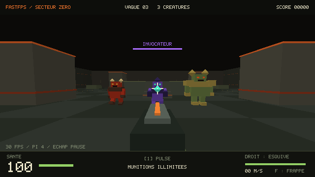

# FASTFPS — Secteur zéro

**FPS 3D natif, style Doom, pensé pour le Raspberry Pi 4.** Base à améliorer progressivement : déplacement nerveux, quatre armes à débloquer et survie dans trois arènes industrielles. Version **0.9.2** : plateformes qui desservent des postes en hauteur, soins sur les balcons et coéquipiers plus détaillés.

Application en **C11**, **SDL2** (fenêtre, clavier, souris et son) et **OpenGL ES 2** (rendu 3D). Graphismes, police et bruitages sont générés localement. Les musiques MP3 sont lues avec **mpg123**.

Le mode solo fonctionne hors ligne. Pour jouer ensemble, sélectionne **Multijoueur** ; voir [MULTIJOUEUR.md](MULTIJOUEUR.md) pour la création, la connexion sur Internet et les limites de cette première version.

## Nouveautés — version 0.9.2

- **Les plateformes ont désormais des destinations sur les trois maps.** Deux ascenseurs bleus rejoignent des balcons à **3,48 m**, avec couvertures, garde-corps extérieurs et deux postes de soins. Le passage au sol reste ouvert sous les balcons. Ascenseur de gauche dans la moitié nord, celui de droite dans la moitié sud ; repère les panneaux **LIFT** et les bordures bleues. Marche dessus lorsqu’ils sont en bas, attends le palier puis avance vers le balcon.
- **Navette orange en hauteur** : elle relie les deux balcons, au-dessus du combat, en traversant environ **31 mètres**. Embarque depuis la bordure orange du balcon ; à l’autre bout, marche vers le palier. Les plateformes marquent un arrêt aux deux extrémités (environ 1,3 / 1,4 s pour les ascenseurs, 1,9 s pour la navette), puis accélèrent et ralentissent progressivement.
- **Les deux nouveaux soins rendent 25 PV** et reviennent après **30 secondes**, contre 18 s pour les quatre soins au sol. Il faut monter pour les récupérer ; passer en dessous ne suffit pas. Les couverts et la hauteur permettent de changer de ligne de tir et d’éviter une onde de choc au sol, mais les tirs des invocateurs peuvent toujours t’atteindre.
- **Sauts depuis une plateforme mobile** : l’élan horizontal de la navette est conservé, avec un court délai de contrôle aérien ; un ascenseur qui monte apporte une petite impulsion verticale supplémentaire. Aucun saut n’est déclenché automatiquement.
- **Coéquipiers plus expressifs** : armures géométriques avec casques, visières, épaulières, gants, genouillères, bottes et sacs dorsaux. Quatre couleurs cohérentes avec la liste de l’équipe, numéros à l’avant et à l’arrière. Chaque arme possède sa silhouette, y compris le lance-roquettes.
- Marche articulée, inclinaison latérale, jambes repliées en saut, regard et arme orientés avec la visée, recul, recharge, changement d’arme, frappe et aide à un allié. Un joueur à terre conserve sa taille et apparaît couché ; son arme est masquée.
- **Identification dans la vue du joueur** : noms, couleur et santé au-dessus des coéquipiers visibles à moins de 25 m ; état à terre et progression de réanimation si nécessaire. Les murs masquent les étiquettes. Le nom et la santé de chaque allié restent dans la liste de l’équipe.

**Multijoueur : protocole 8. Mets tous les ordinateurs à jour en 0.9.2.** Les nouvelles collisions et trajectoires ne sont pas compatibles avec la prédiction des versions précédentes. Les animations réutilisent les états déjà transmis et les maillages existants ; les cinq appels de dessin et les capacités de buffers sont conservés. Voir [VALIDATION.md](VALIDATION.md) pour les vérifications effectuées et celles restant à faire en jouant.

## Rappel — version 0.9.1

- Si tu joues avec le volume musical à zéro, un petit rappel de huit secondes indique **« Tu joues sans musique / Échap > Réglages > Musique »**. Il apparaît une fois par partie, sans interrompre le combat, et disparaît dès que tu actives la musique. Il reste masqué pendant la pause, les modules et l’affichage de ta configuration ; pas de rappel en démo ou avec `--mute`.

## Musique — version 0.9.0

- **Menu et salons : Blank Shell**, premier fichier du dossier Musique. **Combat : General Release**, deuxième fichier. Copies locales dans `assets/music/menu.mp3` et `assets/music/gameplay.mp3` ; les originaux restent dans le dossier Musique.
- **Réglages → Musique** : volume de **0 à 100 %**, réglé sur **0 par défaut**, y compris lors de la migration des anciens réglages. Glisse le slider, clique sur la valeur pour la saisir, ou utilise les flèches gauche / droite. Le volume est conservé à la fermeture normale. Les bruitages et F3 restent indépendants ; `--mute` coupe tout l’audio.
- Fondus de volume (0,4 s), transition entre morceaux (1,3 s), boucles avec bords adoucis et fondu de sortie (0,18 s). Pause et joueur à terre : musique assourdie et atténuée ; choix de modules : atténuation légère. Une petite queue d’écho accompagne les transitions, et les bruitages atténuent légèrement la musique pour rester audibles.
- Lecture en continu sur un thread, deux buffers stéréo de taille fixe (environ 256 Ko au total), sans décodage ni accès disque dans le callback audio. Le morceau inactif et le volume à zéro suspendent la consommation des buffers. Si un fichier manque, le jeu et les bruitages restent utilisables.
- Aucun changement du protocole réseau 7 : la musique et son volume sont locaux à chaque ordinateur.

## Nouveautés — version 0.8

- **Champions : saut et écrasement au sol.** Le champion prépare son saut pendant 0,75 seconde. Le cercle orange de six mètres annonce sa cible ; celle-ci est fixée avant le décollage. Il saute réellement avec gravité et collisions, frappe à l’atterrissage, puis récupère. Les murs bloquent le choc ; sauter assez haut au bon moment ou quitter le cercle permet de l’éviter. Les dégâts sont appliqués une seule fois à l’impact.
- **IA des ennemis** : cibles privilégiées selon leur visibilité, maintien de la cible pour éviter les changements incessants, itinéraires propres à chaque joueur en coopération, contournement des obstacles, séparation du groupe et tentatives de sortie lorsqu’un ennemi se bloque. Les traqueurs approchent par les côtés ; les invocateurs reculent si tu es trop près, se déplacent latéralement à distance et anticipent ton mouvement avant leur tir.
- **Menu principal et Réglages séparés** : grandes actions Solo, Multijoueur, Réglages, Quitter ; raccourcis et contexte de partie affichés à droite. Les sliders et la saisie de luminosité / sensibilité sont conservés dans Réglages. Échap revient au menu précédent.
- **Réanimation obligatoire en coopération** : aucun retour automatique. Approche-toi à moins de 2,8 mètres et maintiens **E pendant 2,5 secondes**, avec une ligne de vue libre. Relâcher E, s’éloigner, perdre la ligne de vue ou subir des dégâts interrompt la progression. Le joueur réanimé conserve ses modules et chargeurs, retrouve 50 % de sa santé maximale et bénéficie de deux secondes de protection. Une icône au-dessus du corps et une barre indiquent l’état. Si tous les joueurs actifs sont à terre, game over immédiat. Le solo conserve ses trois vies.
- **Pop-up à chaque nouvelle arme** : carte visible pendant six secondes au déblocage des armes aux rounds 10, 20 et 30, avec le nom et la touche. Le combat continue pendant son affichage.
- **Événement rare : Roquettes !** À partir du round 3, l’hôte effectue un tirage de 8 % par round éligible, avec au moins cinq rounds entre événements. Chaque joueur, même à terre, reçoit un lance-roquettes temporaire pour ce round, automatiquement équipé. **5** ou la molette permet de le sélectionner ensuite. Trois roquettes par chargeur, recharge de 2,1 secondes, réserves illimitées pendant l’événement. Les roquettes infligent des dégâts de zone sur 6,5 mètres, avec diminution selon la distance et blocage par les murs. Les explosions ne font pas de tirs à la tête. Elles ne blessent pas directement les alliés ; le tireur peut subir ses propres dégâts et faire un **rocket jump**. Les barils restent dangereux pour toute l’équipe. À la fin du round, le lanceur est retiré et l’arme précédant l’événement est restaurée si nécessaire.
- **Mobilité sur les trois maps** : deux plaques élévatrices montent jusqu’à 3,48 mètres et une navette se déplace horizontalement. Monte dessus à leur passage ou saute dessus, puis utilise-les pour atteindre les hauteurs. Les joueurs, ennemis et corps peuvent être transportés. Une plaque descendante dégage un personnage vers un côté libre plutôt que de l’enfermer. Positions et collisions sont calculées depuis le temps de simulation de l’hôte et rejouées pour la prédiction locale.

La **0.8** utilisait le **protocole réseau 7** ; la **0.9.2** utilise le **protocole 8**. Mets à jour tous les ordinateurs avant une partie ; les salons des anciennes versions sont incompatibles. Les invitations LAN / Tailscale fonctionnent comme auparavant. Voir [VALIDATION.md](VALIDATION.md) pour les tests réalisés et les limites des mesures.

## Nouveautés — version 0.7

- **Solo : trois vies au total.** Une mort consomme une vie ; tant qu’il en reste, retour après trois secondes, avec deux secondes de protection. Les modules, armes et rounds atteints sont conservés. Le combat s’arrête pendant ce bref retour. Après la troisième mort, écran de game over et possibilité de recommencer.
- **Coopération : réanimation par un allié avec E ; game over dès que tous les joueurs actifs sont à terre simultanément.** Chaque joueur peut revenir au salon ; l’hôte peut lancer une nouvelle partie. Un joueur isolé dans un salon suit cette règle de coopération.
- **Trois maps** : Réacteur (plateforme et piliers), Fonderie (lignes de machines et passages latéraux), Bastion (murs décalés et couvertures). Réacteur pour les rounds 1–5, Fonderie pour 6–10, Bastion pour 11–15, puis le cycle recommence. Chaque changement replace l’équipe à une position libre, avec deux secondes de protection.
- **Difficulté accrue** : jusqu’à 18 ennemis, courses et projectiles plus rapides, résistance croissante et dégâts augmentés en Normal / Brutal. Les soins donnent 25 PV, reviennent après 18 secondes et les fins de vague rendent 10 PV.
- **Modules protégés contre les clics accidentels** : une seconde de blocage, relâchement du tir, puis sélection d’une carte. Confirme avec **Entrée ou le bouton Valider**, situé sous les cartes. Cliquer plusieurs fois sur une carte ne l’installe pas. La sélection automatique après 15 secondes reste annoncée à l’écran ; le module installé apparaît par son nom.
- **Luminosité de 50 à 200 %** et **sensibilité de 0,30 à 3,00** : glisse les sliders, clique sur la valeur pour la saisir, puis valide avec Entrée. Les valeurs dépassant les limites sont ramenées aux bornes ; une saisie invalide conserve le réglage précédent. Échap annule la saisie. Flèches gauche / droite pour ajuster au clavier, Entrée sur la ligne pour écrire. Réglages sauvegardés à la fermeture normale du jeu.

### Armes et rechargement

| Touche | Arme | Disponible à partir du round | Chargeur | Rechargement |
| --- | --- | --- | --- | --- |
| 1 | Pulse | 1 | 18 | 1,25 s |
| 2 | Fusil à pompe | 10 | 6 | 1,85 s |
| 3 | Mitrailleuse | 20 | 32 | 1,65 s |
| 4 | Lance rail | 30 | 4 | 2,10 s |

**R** recharge un chargeur partiellement utilisé. Un chargeur vide déclenche automatiquement le rechargement. Pendant ce geste, le tir, la frappe et le changement d’arme sont bloqués ; tu peux toujours courir, sauter et esquiver. Les réserves sont illimitées dans cette base : la contrainte est le chargeur et le temps nécessaire pour le remplir. Les chargeurs sont indépendants par arme et sont remplis lors d’une réapparition. Les déblocages sont limités à la partie actuelle.

La molette parcourt uniquement les armes disponibles. **Tab** affiche les modules et l’arsenal, avec les prochains rounds de déblocage. Le HUD affiche le chargeur et une barre de rechargement ; le modèle de l’arme, la main et le chargeur accompagnent le geste.

**Multijoueur : tous les ordinateurs doivent être mis à jour en 0.8**, qui utilise le protocole réseau 7. Les anciennes versions ne peuvent pas rejoindre ces salons. Les maps, choix, armes et chargeurs restent décidés par l’hôte.

## Graphismes — version 0.6

- Arène industrielle avec panneaux muraux, plaques, conduites, traverses, grilles au sol et caisses renforcées.
- Surfaces avec joints de panneaux et variations procédurales de matière ; aucun téléchargement de textures.
- Créatures, casques, armures et armes avec coins biseautés, canons cylindriques, détails de visage et normales corrigées.
- Surfaces lumineuses dédiées pour les yeux, le réacteur, les projectiles, les soins et les effets de combat.
- Deux sources de lumière de combat : tirs, explosions, armes des alliés et charge des invocateurs.
- Mode **Moderne** : luminosité / contraste ajustés, agrandissement lissé et, sur Pi+ / Équilibré / PC, éclairage par pixel, reflets et bloom léger.
- Mode **Rétro** : éclairage simplifié, agrandissement sans lissage et glow de post-traitement désactivé. Change de style avec **F5** ou dans le menu ; le réglage est sauvegardé.
- HUD et menus dessinés à la résolution de la fenêtre, après les effets de la 3D : texte net et effets de bloom limités à la scène.
- Captures BMP composées avec les effets visuels et l’interface.

Pour essayer le nouveau compromis sur le Pi :

```bash
./lancer.sh --quality pi-plus --modern
```

**F2** parcourt Pi → Pi+ → Équilibré → PC. Le profil Pi garde 640 × 360 et un éclairage moins coûteux. Pi+ vise 30 FPS à 854 × 480, avec les effets avancés. La nouvelle version n’a pas encore été mesurée sur un Pi réel ; utilise le compteur FPS pour choisir ton profil.

## Progression pendant la partie — version 0.5

Après chaque vague terminée, chaque joueur choisit un module parmi trois propositions. Après le délai de protection, clique sur une carte ou utilise **1 / 2 / 3** pour la sélectionner ; confirme avec **Entrée ou le bouton Valider**. Les flèches permettent aussi de choisir avant Entrée. Tu as jusqu’à **15 secondes** ; à expiration, la première proposition est appliquée. Quand tous les joueurs ont choisi, la prochaine vague commence après un compte à rebours de trois secondes.

| Module | Bonus par rang |
| --- | --- |
| Surcharge | +12 % de dégâts des armes et de la frappe |
| Cadence | +10 % de cadence de tir |
| Réflexes | −10 % de délai de recharge d’esquive, +3 % de vitesse |
| Vitalité | +15 santé maximum et +15 santé à l’installation |
| Blindage | −6 % de dégâts reçus |
| Vampirisme | +2 santé par élimination |

Chaque module a **cinq rangs**. Les bonus s’additionnent par rang ; tu peux ainsi orienter ton personnage vers les dégâts, la mobilité ou la survie. Le niveau du personnage augmente à chaque module installé. **Tab** affiche ta configuration actuelle. Les améliorations restent actives après une réanimation en coopération et sont remises à zéro au début d’une nouvelle partie.

Toutes les **cinq vagues**, un champion doré apparaît : il est plus grand et résistant, vaut cinq fois les points d’un ennemi ordinaire et prépare une attaque de zone. Un cercle au sol annonce sa portée ; quitte la zone avant le choc. Vaincre le champion ouvre le secteur suivant, avec une nouvelle ambiance lumineuse. Les trois maps alternent tous les cinq rounds, avec quatre thèmes de lumière qui se répètent. La survie continue ensuite, avec une résistance ennemie qui augmente progressivement.

Les éliminations affichent leurs points à l’écran. L’écran de fin résume le niveau atteint, les vagues terminées, les éliminations et les impacts à la tête.

## Graphismes 0.5

- Réacteur central animé : cristal, anneaux inclinés en rotation et satellites d’énergie.
- Éclairage des tirs et explosions calculé sur les sommets, ambiance de secteur et légère vignette.
- Ombres stylisées sous les créatures, les corps et les alliés.
- Anneaux d’apparition, animation d’installation des modules et cercles d’attaque du champion.
- Armes détaillées, accents énergétiques, renforts visibles après deux rangs de Surcharge et accents dorés dès le troisième rang.
- Flashs de bouche étoilés, douilles éjectées, respiration au repos et abaissement de l’arme pendant l’esquive.
- Interface de choix avec cartes animées, emblèmes, aperçu du rang suivant et compteur d’intermission.

## Nouveautés 0.4

- Barils rouges explosifs : deux tirs de blaster, dégâts de zone et réactions en chaîne. Les murs arrêtent les explosions. Elles peuvent blesser les joueurs ; reste à distance. Les barils détruits reviennent à la vague suivante si aucun joueur n'est trop proche.
- Tirs à la tête : dégâts ×2 et +50 points sur une élimination. Confirmation bleue pour la tête, dorée pour une élimination.
- Flèche indiquant la provenance des dégâts, alerte de santé basse, compte à rebours des vagues et santé des alliés.
- Difficultés **Détente**, **Normal** et **Brutal**, réglables dans le menu. En coopération, l'hôte choisit ; le nombre et la résistance des ennemis s'adaptent aussi au nombre de joueurs en vie au début de la vague.
- Repères numérotés, enseignes, éclairages géométriques et indication de recharge des soins dans l'arène.
- Salons locaux détectés automatiquement, invitation à copier/coller, adresses VPN prioritaires, invités prêts automatiquement et latence affichée.
- Pseudo, dernière adresse, port et difficulté mémorisés à la fermeture normale.

Pour jouer à distance sur Linux / Raspberry Pi : `./reseau.sh vpn` installe Tailscale si nécessaire et ouvre la connexion au compte. Chaque joueur utilise son compte et rejoint le même réseau privé. Active le VPN **avant** de créer le salon ; copie l'invitation dans le salon et colle-la avec `Ctrl+V` chez l'invité. `H` affiche l'aide réseau dans le jeu. Le script suit l'[installation officielle Tailscale](https://tailscale.com/docs/install/linux) et demande les droits système lors de l'installation.

## Lancer sur cette machine

```bash
cd ~/Projets/fastfps
./lancer.sh
```

Le lanceur compile les fichiers modifiés puis ouvre la fenêtre. Le binaire compilé peut aussi être lancé directement avec `./build/fastfps`.

Sélectionne **Jouer** avec la souris ou les flèches, puis clique ou appuie sur `Entrée`. Le jeu capture la souris. `Échap` met en pause et libère la souris ; appuie de nouveau sur `Échap` ou sélectionne **Reprendre** pour continuer. Choisis **Quitter** pour fermer l’application.

`FastFPS.desktop` est un raccourci pour `/home/rdb/Projets/fastfps`. Le gestionnaire de fichiers peut demander de l’autoriser avant de le lancer. Si tu déplaces le projet, adapte ses chemins `Exec` et `Path`.

## Installation sur Raspberry Pi 4

Utilise **Raspberry Pi OS avec une session graphique**, un clavier et une souris. Dans un terminal du Pi :

```bash
sudo apt update
sudo apt install build-essential pkg-config libsdl2-dev libgles-dev libmpg123-dev
```

Copie le dossier `fastfps` dans `~/Projets` sur le Pi, puis compile **sur le Pi** :

```bash
cd ~/Projets/fastfps
make clean
make -j2
./lancer.sh --quality pi
```

Le binaire fourni dans `build/` est compilé pour la machine de développement et ne doit pas être utilisé tel quel sur ARM. `make clean` efface uniquement les fichiers compilés. Une fois les dépendances installées et le jeu compilé, il fonctionne hors ligne.

Le Pi 4 possède un GPU compatible OpenGL ES ([documentation Raspberry Pi](https://www.raspberrypi.com/documentation/computers/processors.html)). Le jeu utilise uniquement les API OpenGL ES 2. Le démarrage direct sur Raspberry Pi OS Lite sans session graphique n’est pas pris en charge dans ce guide.

## Commandes

| Action | Commande |
| --- | --- |
| Se déplacer | ZQSD / WASD ou les flèches |
| Viser / tirer | Souris / clic gauche, maintenir pour tirer en continu |
| Sprint | Maj |
| Sauter | Espace ; maintenir pour enchaîner à l’atterrissage |
| Esquive dans la direction du mouvement | Clic droit ou Alt gauche ; recharge de 1,25 seconde |
| Frappe au corps à corps | F ; une élimination rend 10 points de santé |
| Choisir une arme disponible | 1 / 2 / 3 / 4 / 5 ; molette pour changer |
| Réanimer un allié en coopération | E maintenu pendant 2,5 secondes, près du corps |
| Recharger | R ; automatiquement lorsque le chargeur est vide |
| Choisir un module entre les vagues | Clic, 1 / 2 / 3 ou flèches ; Entrée / bouton Valider pour confirmer |
| Afficher / masquer les modules installés | Tab |
| Pause / reprendre | Échap |
| Plein écran | F11, ou le menu |
| Afficher / masquer les FPS | F1 |
| Changer le profil de rendu | F2, ou le menu |
| Activer / couper les bruitages | F3, ou le menu |
| Volume de la musique | Réglages → Musique, slider ou saisie de 0 à 100 % |
| Réduire les mouvements de caméra | F4, ou le menu |
| Style Moderne / Rétro | F5, ou le menu |

Les déplacements utilisent les positions physiques du clavier : ZQSD sur AZERTY et WASD sur QWERTY.

## Gameplay

- Arène avec piliers, caisses, passages latéraux et plateforme accessible par des marches.
- Pulse précis à tir continu, fusil à pompe à neuf plombs, mitrailleuse rapide et lance rail puissant. Chargeurs limités, rechargement obligatoire à vide et réserves illimitées.
- Barils explosifs et tirs à la tête ; les explosions représentent un danger pour toute l'équipe.
- Trois types d’ennemis avec silhouettes, couleurs et animations distinctes ; voir le tableau ci-dessous.
- Vagues progressives : quatre ennemis au départ, douze maximum. Navigation en grille pour contourner les obstacles.
- Croix vertes : +25 santé, réapparition après 18 secondes. Terminer une vague : +10 santé.
- Score, record et réglages persistants. Ils sont enregistrés à la fermeture d’une partie normale via `SDL_GetPrefPath`, généralement dans `~/.local/share/fastfps/fastfps/settings.txt` sous Linux.

Direction : **Doom moderne simplifié**, mouvement direct, sprint, combat à courte et moyenne distance, arme centrée et ambiance industrielle. Les modèles géométriques sont provisoires.

| Ennemi | Apparence | Comportement |
| --- | --- | --- |
| Traqueur | Rouge, cornes, silhouette légère | Poursuit vite et prépare une frappe au contact |
| Invocateur | Violet, silhouette étroite, coiffe pointue et énergie verte | Se déplace latéralement, charge une boule d’énergie avant de tirer |
| Brute, à partir de la vague 3 | Vert olive, grandes épaulières dorées, corps plus massif | Avance lentement, résiste davantage et prépare une frappe plus longue et plus forte |



Une attaque ennemie est annoncée par un mouvement et un son. Évite-la en changeant de direction ou avec l’esquive. Les impacts font reculer les ennemis ; les créatures légères sont davantage interrompues que la brute. Le nom et la santé de l’ennemi visé s’affichent sous le haut de l’écran.

Une série d’éliminations espacées de moins de 3,5 secondes augmente le score : multiplicateur ×2 dès la quatrième élimination, ×3 dès la septième et ×4 dès la dixième.

## Animations et immersion

- Créatures orientées vers leur cible, bras et jambes articulés, respiration au repos et démarches propres aux types.
- Préparation des attaques, concentration d’énergie de l’invocateur, réactions aux impacts et chute à la mort.
- Corps visibles quelques secondes, avec un maximum de huit pour limiter le coût.
- Mains autour des armes, recul, flamme de bouche, changement d’arme animé et mouvement de pompe après chaque tir du fusil.
- Balancement de l’arme pendant la marche, inertie légère lors de la visée et amortissement de l’atterrissage.
- Pas, réarmement, esquive et cris synthétiques ; les sons des ennemis sont atténués avec la distance et placés à gauche ou à droite en stéréo.

`F4` réduit le balancement, l’inertie de visée et les mouvements de caméra. Les attaques et poses des personnages restent visibles. Le changement d’arme dure 0,32 seconde ; il interrompt brièvement le tir et conserve le délai entre tirs.

## Réglages Raspberry Pi

| Profil | Résolution interne | Limite | Particules maximum |
| --- | --- | --- | --- |
| Pi 4, par défaut | 640 × 360 | 30 FPS | 64 |
| Pi+ | 854 × 480 | 30 FPS | 80 |
| Équilibré | 960 × 540 | 60 FPS | 100 |
| PC | 1280 × 720 | 60 FPS | 160 |

En plein écran, la 3D reste à la résolution choisie puis est agrandie avec lissage en mode Moderne ou sans lissage en mode Rétro. L’interface utilise la résolution de la fenêtre. Des bandes noires préservent les proportions 16:9.

Cinq appels de dessin par image : décor, objets mobiles, arme, agrandissement avec effets, puis interface à la résolution de la fenêtre. Décor chargé une seule fois sur le GPU, tableaux et buffers réutilisés, aucune allocation dans la boucle normale de jeu. Les animations transforment les sommets dans ces mêmes buffers, sans ajouter d’appels de dessin. Les matériaux sont générés dans le shader, avec des effets plus simples sur le profil Pi. Les ombres stylisées restent géométriques ; aucun rendu supplémentaire de cartes d’ombres. Les effets de contraste, vignette et bloom sont intégrés à l’agrandissement existant. La texture de scène est réutilisée ; les captures allouent une cible temporaire uniquement au moment de l’export. Simulation à pas fixe de 60 Hz ; navigation partagée calculée environ trois fois par seconde.

**Un essai sur Raspberry Pi a été rapporté comme satisfaisant par l’utilisateur pour la version précédente. Les nouvelles mécaniques et les vagues de la 0.8 restent à mesurer ; aucune valeur de FPS réelle n’a été fournie.** La fluidité dépendra du matériel, des pilotes et de la température. Les inspections visuelles ici utilisent un rendu logiciel hors écran sur la machine de développement ; elles ne mesurent pas les performances du Pi. Le compteur FPS permet une première mesure en jeu.

## Options

```bash
./lancer.sh --quality pi --fullscreen
./lancer.sh --quality pi-plus --modern
./lancer.sh --quality balanced
./lancer.sh --retro
./lancer.sh --mute
./lancer.sh --difficulty hard
./lancer.sh --multiplayer
./lancer.sh --join fastfps://100.101.102.103:27015
./build/fastfps --help
```

Démonstration automatique pour inspecter le rendu :

```bash
./build/fastfps --demo --mute --frames 120 --screenshot capture.bmp
```

Le mode démo contrôle le joueur, ferme le jeu après le nombre d’images demandé et n’enregistre pas les réglages. Capture BMP à la résolution interne.

## Développer

```bash
make -j2
make run
make clean
```

| Fichier | Rôle |
| --- | --- |
| `src/config.h` | Vitesses, gravité, saut, limites d’entités |
| `src/fastfps.h` | Types et interfaces entre modules |
| `src/main.c` | Fenêtre, événements, menu, réglages et boucle |
| `src/world.c` | Carte, obstacles et navigation |
| `src/physics.c` | Collisions, déplacement, gravité et marches |
| `src/game.c` | Armes, ennemis, projectiles, soins, vagues et score |
| `src/weapons.c` | Arsenal, chargeurs et événement roquettes |
| `src/ai.c` | Choix de cible, contournement, séparation et stratégies des ennemis |
| `src/mobility.c` | Plateformes mobiles, transport et sécurité des collisions |
| `src/menu.c` | Écrans principaux, navigation et menu de réglages |
| `src/presets.c` | Profils graphiques partagés |
| `src/settings.c` | Sliders et saisie numérique des réglages |
| `src/progression.c` | Bonus des modules, propositions, choix et interface |
| `src/graphics.c` | Réacteur, ombres stylisées et effets d’arène |
| `src/renderer.c` | OpenGL ES, caméra, modèles et résolution |
| `src/animation.c` | Poses des ennemis, articulations et animations des armes |
| `src/teammate.c` | Armures, identification et animations des coéquipiers |
| `src/network.c`, `src/network.h` | Connexions, salon, commandes et prédiction |
| `src/discovery.c` | Recherche LAN, adresses VPN et invitations |
| `src/protocol.c` | Encodage portable et validation des messages |
| `src/lobby.c` | Écrans de création, connexion et attente |
| `src/mesh.c` | Maillages et police bitmap locale |
| `src/ui.c` | Menu et interface de combat |
| `src/audio.c` | Synthèse et mélange des bruitages et de la musique |
| `src/music.c` | Lecture MP3 en continu, fondus et effets de musique |
| `src/math.c` | Vecteurs, matrices et intersections |

Carte et paramètres sont actuellement dans les sources. Aucune option de compilation spécifique à x86 : les mêmes fichiers sont compilables sur ARM.

## Limites et suite

Trois cartes et un mode survie solo ou coopératif, quatre armes permanentes par run, un lance-roquettes temporaire et un rechargement par chargeur. Collisions par boîtes, trajectoires parfois anguleuses. Pas encore de rampes, accroupissement, sauvegarde de partie ou manette.

La coopération utilise un joueur hôte qui fait autorité sur le monde, un état d’entrée `Input`, des identifiants d’ennemis stables, une prédiction du déplacement et une interpolation à l’affichage. La connexion se fait par IPv4 et port TCP, sans service central dans le jeu. Tailscale utilise ses propres services de connexion et éventuellement de relais. La validation entre deux machines et sur Internet reste à faire : voir [VALIDATION.md](VALIDATION.md). La version 0.9.2 utilise le protocole 8, incompatible avec les versions précédentes. Tous les joueurs doivent avoir la même version de gameplay.

Voir [ROADMAP.md](ROADMAP.md). Le prototype navigateur est conservé dans `prototype-web/` comme archive ; le lanceur principal utilise **l’application native**.

API utilisées : [SDL2](https://wiki.libsdl.org/SDL2/FrontPage), [capture relative de souris](https://wiki.libsdl.org/SDL2/SDL_SetRelativeMouseMode).
